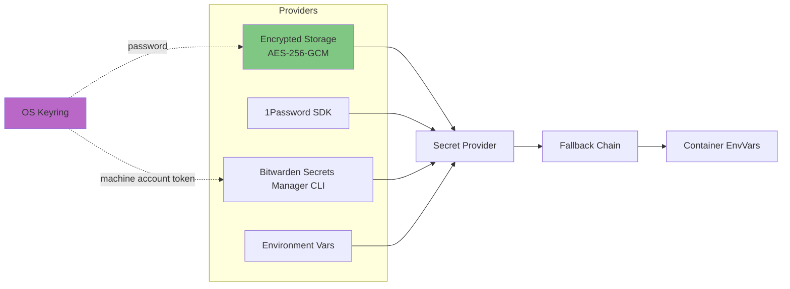

# Secrets Management

ToolHive provides a secrets management system for securely handling API keys, tokens, and other sensitive data needed by MCP servers.

## Architecture



## Provider Types

**Implementation**:
- `pkg/secrets/factory.go` (`ProviderType` enum: `EncryptedType`, `OnePasswordType`, `BitwardenType`, `EnvironmentType`)
- `pkg/secrets/types.go` defines the `Provider` interface (the contract every provider implements) and the `EnvVarPrefix` constant (`"TOOLHIVE_SECRET_"`) used by the environment provider

### 1. Encrypted

- **Storage**: Platform-specific XDG data directory
  - Linux: `~/.local/share/toolhive/secrets_encrypted`
  - macOS: `~/Library/Application Support/toolhive/secrets_encrypted`
  - Windows: `%LOCALAPPDATA%/toolhive/secrets_encrypted`
- **Encryption**: AES-256-GCM
- **Password**: Stored in OS keyring (keyctl/Keychain/DPAPI)
- **Capabilities**: Read, write, delete, list

**Implementation**: `pkg/secrets/encrypted.go`

### 2. 1Password

- **Storage**: 1Password vaults
- **Access**: Via 1Password SDK (`github.com/1password/onepassword-sdk-go`)
- **Authentication**: Service account token (`OP_SERVICE_ACCOUNT_TOKEN`)
- **Capabilities**: Read-only, list

**Implementation**: `pkg/secrets/1password.go`

### 3. Environment

- **Storage**: Environment variables (`TOOLHIVE_SECRET_*`)
- **Use case**: CI/CD, stateless deployments
- **Capabilities**: Read-only (ListSecrets explicitly disabled for security)
- **Security**: Prevents enumeration of all environment variables

**Implementation**: `pkg/secrets/environment.go`

### 4. Bitwarden Secrets Manager

- **Provider name**: `bitwarden`
- **Storage**: Bitwarden Secrets Manager, accessed through a separately installed `bws` CLI
- **Authentication**: Machine account access token in the OS credential store, with an optional `BWS_ACCESS_TOKEN` override
- **Capabilities**: Read and list; create, update, and delete secrets in Bitwarden itself
- **References**: `bws://<UUID>` identifies a secret by its stable ID, not its display name

**Implementation**: `pkg/secrets/bitwarden.go`, `pkg/secrets/clients/bitwarden.go`

#### Setup and use

Install the Bitwarden Secrets Manager CLI (`bws`) and create a machine account
with read access to only the required projects or secrets. Use a separate access
token for each computer so you can revoke its access independently. ToolHive
does not install `bws` or create the account.

The `bws` executable must be on the process's `PATH`. Alternatively, set
`TOOLHIVE_BWS_PATH` to its absolute path. Configure any required Bitwarden server
settings for that CLI before using the provider.

With those prerequisites available:

```bash
# Enter the machine account token at a hidden prompt, validate it, and save it locally.
thv secret bitwarden login

# Validate Bitwarden access and initialize local encrypted OAuth storage.
thv secret provider bitwarden

# List secret references and display names, without their values.
thv secret list

# Inject a secret into an MCP server's environment.
thv run my-server \
  --secret 'bws://12345678-1234-4234-8234-123456789abc,target=API_KEY'
```

Interactive `thv secret setup` also offers Bitwarden and prompts for a token
when none is configured. Setup validates access by listing secrets and
initializes the writable local encrypted store used for internal credentials.
It requires a working OS keyring. If a local store already exists, its existing
keyring password is retained. Setup does not copy user secrets to Bitwarden or
change running workloads.

References require the hyphenated UUID of a secret. Duplicate display names are
allowed because lookup uses the UUID. Bitwarden failures, including invalid
references, denied access, and connectivity failures, return an error without
falling back to a different secret source. Values are resolved when the workload
starts; changing a value in Bitwarden does not update an already-running
container's environment.

For a registry server that requires secrets, provide an explicit `--secret`
mapping for each required secret. ToolHive cannot save an interactively entered
value through this read-only provider.

#### Access token storage and precedence

`thv secret bitwarden login` validates the entered token with `bws` before saving
it. The token uses persistent native credential storage:

| Platform | Credential store |
|----------|------------------|
| macOS | Keychain |
| Windows | Credential Manager |
| Linux | Secret Service, such as GNOME Keyring |

The dedicated credential has service name `toolhive-bitwarden` and account name
`access-token`. It is separate from the password protecting the local encrypted
OAuth store. ToolHive does not search other credential entries or fall back to
plaintext files or Linux's session-only `keyctl` storage for this token.

When `BWS_ACCESS_TOKEN` is set, it takes precedence over the saved token. An empty
or invalid override fails instead of trying the saved credential. ToolHive does
not automatically save environment-provided tokens. This supports CI and
headless deployments that inject the token from their own secret store.
Otherwise, ToolHive reads the native credential and passes the token to the
`bws` child process through its environment. Keep tokens out of shared
configuration files; portable workload configurations contain `bws://` references.

To save a token supplied by another local secret tool, pipe its output into
`thv secret bitwarden login --token-stdin`. The normal login command requires an
interactive terminal and does not accept tokens as command-line arguments.
Running login again validates and replaces the saved token.

```bash
# Remove the saved token from this computer.
thv secret bitwarden logout
```

Logout only removes the local credential. It does not revoke the access token in
Bitwarden, clear an environment override, or stop running workloads. Revoke a
compromised or retired token in Bitwarden itself.

#### User secrets and internal credentials

ToolHive separates user-supplied secrets from internal credentials. With
Bitwarden selected, user references are read from Bitwarden, while OAuth tokens,
dynamically registered client credentials, and registry authentication state use
the local encrypted provider. Internal credentials are scoped separately from
user secrets. ToolHive never writes OAuth refreshes to Bitwarden.

Selecting Bitwarden records this separation in configuration:

```yaml
secrets:
  provider_type: bitwarden
  system_provider_type: encrypted
  setup_completed: true
```

For existing configurations without `system_provider_type`, internal storage
continues to follow the selected user provider, except that `bitwarden` resolves
to `encrypted` for internal storage. An explicit `system_provider_type` supports
only `encrypted` and is independent of the `TOOLHIVE_SECRETS_PROVIDER` override.
This preserves the provider selection of existing installations. Selecting a
provider does not migrate credentials between stores or rewrite existing
workload references; plan those changes separately.

#### Background processes and restarts

Every process that resolves a Bitwarden reference needs access to `bws` and
either the saved native credential or a `BWS_ACCESS_TOKEN` override. A saved
token survives restarts; desktop applications and detached processes must run
as the same OS user with access to that user's unlocked credential store. Linux
Secret Service also requires access to the user's session bus. The OS may prompt
to unlock the store or authorize access. If access fails, ToolHive returns an
error; it does not prompt for a token during secret retrieval or silently switch
storage backends.

For headless services, inject `BWS_ACCESS_TOKEN` through the service's secret
management mechanism. Setting it in a terminal does not provision an
already-running `thv serve`, desktop application, or login service. Configure
the actual launcher and restart it to pick up environment changes. Set
`TOOLHIVE_BWS_PATH` there when its `PATH` does not include `bws`.

ToolHive does not install a login service. The local encrypted OAuth store and
its OS keyring entry must also remain available to processes that use internal
credentials. A workload using only local OAuth references does not require a
Bitwarden lookup or token.

## Kubernetes Mode

In Kubernetes/operator mode, ToolHive uses **native Kubernetes Secrets** instead of the provider system. This is a fundamentally different architecture from CLI mode.

### Secret References

MCPServer resources reference Kubernetes Secrets via `SecretRef`. Secrets are injected as environment variables using Kubernetes `SecretKeyRef`.

**Implementation**:
- CRD types: `cmd/thv-operator/api/v1beta1/mcpserver_types.go`
- Pod builder: `cmd/thv-operator/pkg/controllerutil/podtemplatespec_builder.go`

### External Authentication Secrets

OAuth/OIDC client secrets are stored in Kubernetes Secrets and referenced using `SecretKeyRef`:

1. **Token Exchange (MCPExternalAuthConfig)**: OAuth 2.0 client secrets for RFC-8693 token exchange flows
   - **Implementation**: `cmd/thv-operator/api/v1beta1/mcpexternalauthconfig_types.go`
   - **Secret injection**: `cmd/thv-operator/pkg/controllerutil/tokenexchange.go`

2. **OIDC Authentication (MCPOIDCConfig)**: OIDC client secrets for token introspection
   - **CRD field**: `spec.inline.clientSecretRef` on the `MCPOIDCConfig` resource (Go: `MCPOIDCConfig.Spec.Inline.ClientSecretRef`, where `Inline` is of type `*InlineOIDCSharedConfig`), defined in `cmd/thv-operator/api/v1beta1/mcpoidcconfig_types.go`
   - **Secret injection**: `cmd/thv-operator/pkg/controllerutil/oidc.go`
   - **Runtime loading**: `pkg/auth/token.go` (via `TOOLHIVE_OIDC_CLIENT_SECRET` environment variable)

**Pattern**: Secrets are injected as environment variables using Kubernetes `envFrom.secretKeyRef`, keeping them out of ConfigMaps and YAML manifests.

For examples, see [`examples/operator/mcp-servers/`](../../examples/operator/mcp-servers/).

### Third-Party Secret Management

For systems like HashiCorp Vault or External Secrets Operator, use `podTemplateMetadataOverrides` for annotations-based injection.

**Example**: `examples/operator/vault/mcpserver-github-with-vault.yaml`

## Secret Resolution

### Fallback Chain

**Default behavior** (can be disabled):

1. Primary provider (`encrypted` or `1password`)
2. Environment variable (`TOOLHIVE_SECRET_<NAME>`)
3. Error if not found

Bitwarden references fail without environment fallback when retrieval fails.

**Implementation**: `pkg/secrets/fallback.go`, `pkg/secrets/factory.go`

### Usage Pattern

**Command line:**
```bash
thv run my-server --secret "api-key,target=API_KEY"
```

**Process:**
1. Parse: `name=api-key`, `target=API_KEY`
2. Retrieve: `provider.GetSecret("api-key")`
3. Inject: `envVars["API_KEY"] = secretValue`
4. Container receives environment variable

**Implementation**: `pkg/runner/config.go`, `pkg/environment/`

## Security Model

**Encrypted provider:**
- Password in OS keyring (platform-specific secure storage)
- Secrets encrypted at rest (AES-256-GCM)
- File permissions: 0600
- Key derivation: Argon2id over the password with a per-file random salt (16 bytes).
  Cost parameters are the OWASP minimum for Argon2id (19 MiB, 2 iterations, 1 lane)
  and are fixed in code per format version, not stored in the file.

**Threat protection:**
- Plaintext on disk: ✅
- Accidental git commits: ✅
- Log exposure: ✅
- Malicious container: ❌ (has env access)

**Implementation**: `pkg/secrets/aes/aes.go` (AES-256-GCM), `pkg/secrets/keyring/` (OS keyring storage), `pkg/secrets/kdf.go` (Argon2id key derivation), `pkg/secrets/encrypted.go` (file framing and key caching)

**Secrets file format**: a header describing the key derivation, followed by the AES-GCM output.

```
magic    "THVSEC"  6 bytes
version  0x01      1 byte
salt               16 bytes
body               nonce|ciphertext|tag
```

The version selects the Argon2id cost parameters, which live in code. Keeping them
out of the file means no attacker-controllable value reaches Argon2id's memory
allocation, and raising the cost becomes an explicit new format version rather
than a silent per-file property.

Files written before this framing existed have no header and were keyed with an
unsalted SHA-256 of the password. They are detected by the absent magic prefix
and remain readable by current ToolHive releases. Ordinary reads, writes, and
cleanup preserve the legacy format so that older ToolHive binaries can continue
to access the same store. This applies only to existing legacy files: a new
store, including one recreated after the file is deleted, is always written in
the framed format and cannot be read by binaries that predate it.

**Upgrading protection**: run `thv secret upgrade-protection` to explicitly
upgrade a legacy file to the framed Argon2id format. The command requires a
confirmation (or `--yes` for automation), authenticates the legacy ciphertext
before making changes, atomically installs the upgraded file, and verifies it
before reporting success. If post-install verification fails, ToolHive makes a
best-effort atomic restoration of the original encrypted bytes and reports the
failure. An already framed file is left unchanged, and the command refuses to
run when there is no store (or an empty one) to upgrade.

After an upgrade, ToolHive binaries predating the framed format cannot read the
store. Stop or upgrade older local ToolHive processes — including `thv serve`
and detached proxies that persist OAuth refresh tokens — before upgrading.
Secrets already injected into running containers are unaffected. This does not
apply to the Kubernetes path, which uses Kubernetes Secrets rather than this
file.

**Recovering from a rollback**: an older binary opening an upgraded file reports
that the password is incorrect. That message predates this format and does not
indicate corruption — resetting the keyring or deleting the store is the wrong
first step and will lose secrets. The fix is to return to a binary that
understands the framed format. Rolling back to an older binary for real requires
a pre-upgrade copy of the file, kept as securely as the file itself, plus the
password that goes with it.

**Recovering from the pre-fix silent conversion (#6710)**: ToolHive releases
between the introduction of Argon2id (#6657) and this fix (#6710) upgraded a
legacy file to the framed format as a side effect of merely opening it — not
only via an explicit `upgrade-protection` run. If a store was already converted
this way before installing the fix, there is nothing to reverse and no data was
lost: keep the current secrets file and its OS keyring password exactly as they
are. What breaks is any *other* installation or already-running process still on
a binary that predates #6657 — a plain binary swap does not fix a process
already running, since it keeps the old binary loaded in memory. Recovery is:
upgrade every ToolHive installation that accesses this store to a version at or
after this fix, then restart (not just replace) every already-running process —
`thv serve`, detached proxies, and anything else holding the secrets file open —
so each one picks up the new binary. Do not delete the store or reset the
keyring for this; that only discards secrets the file already has.

**What upgrading does and does not protect**: only the live file is upgraded.
Backups taken before upgrade keep the unsalted SHA-256 derivation and stay
cheaply crackable offline. Because the password itself is unchanged, recovering
it from an old backup also decrypts the upgraded file — so retiring old backups
matters as much as the upgrade. Conversely, a backup of the upgraded file is not
a substitute for retaining the password or keyring entry; without them it cannot
be decrypted.

## Integration Points

### RunConfig

Secrets referenced, not embedded:
```json
{
  "secrets": ["api-key,target=API_KEY"]
}
```

Values resolved at runtime, not stored in RunConfig.

### Registry

Registry defines secret requirements:
```json
{
  "env_vars": [{
    "name": "API_KEY",
    "secret": true,
    "required": true
  }]
}
```

**Prompting behavior depends on execution context:**

- **CLI Interactive Mode**: ToolHive prompts for missing required secret values on first run. If a secrets manager is configured, it attempts to retrieve the secret first and only prompts if not found. Prompted values are automatically stored when the secrets manager supports writes. With Bitwarden, supply explicit secret references instead of prompted values.

- **Detached/Background Mode**: Cannot prompt (no TTY). Missing required secrets cause an error. All secrets must be provided via `--secret` flag or pre-configured in secrets manager.

- **Kubernetes Operator**: Cannot prompt. All required secrets must be provided via Kubernetes Secret resources referenced in the workload specification.

### Detached Processes

**Challenge**: Cannot prompt for password

**Solution**: `pkg/workloads/manager.go`
- Parent process retrieves password
- Passed via `TOOLHIVE_SECRETS_PASSWORD` env var to child
- Child uses password without prompting

## Provider Selection

**User provider priority:**
1. `TOOLHIVE_SECRETS_PROVIDER` environment variable
2. Config file: `~/.config/toolhive/config.yaml`
3. Default: `encrypted`

Except for the `environment` provider, setup must be complete before an
environment override can be used. Internal credentials use the separate
selection rules described under [User secrets and internal credentials](#user-secrets-and-internal-credentials).

**Implementation**: `pkg/config/config.go`, `pkg/secrets/factory.go`

## Related Documentation

- [RunConfig and Permissions](05-runconfig-and-permissions.md) - Secrets in configuration
- [Registry System](06-registry-system.md) - Secret requirements
- [Core Concepts](02-core-concepts.md) - Secret terminology
